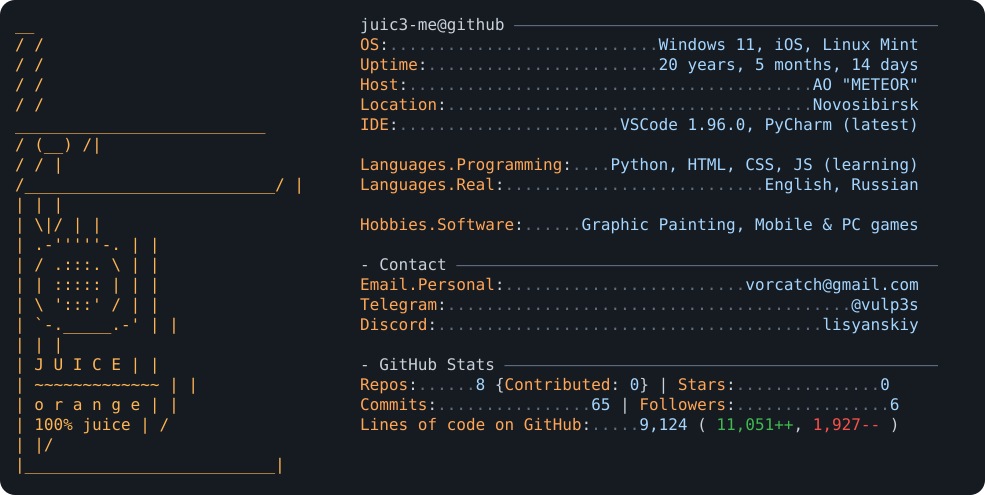
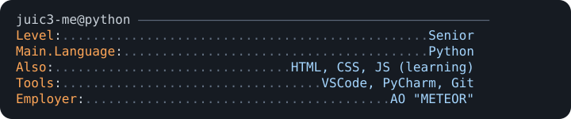

  <a href="https://github.com/Juic3-me">
    <picture>
      <source media="(prefers-color-scheme: dark)" srcset="dark_mode.svg">
      <source media="(prefers-color-scheme: light)" srcset="light_mode.svg">
      
    </picture>
  </a>

 

  
  &nbsp;&nbsp;
  

 

  <picture>
    <source media="(prefers-color-scheme: dark)" srcset="skills_dark_mode.svg">
    <source media="(prefers-color-scheme: light)" srcset="skills_light_mode.svg">
    
  </picture>

 

## About

Python developer based in Novosibirsk, Russia. I work at AO "METEOR".

## Professional level

Python: Senior.

Python is the main language I use in professional work. I write applications, automation tools and scripts in it. For interface work I use HTML and CSS. I am currently learning JavaScript.

Areas of competence:

- application development in Python;
- automation and scripting;
- version control with Git and project hosting on GitHub;
- interface markup and styling with HTML and CSS.

## Languages

English and Russian.

## Interests

Graphic painting, mobile and PC games.

## Technologies

  
  
  
  

  
  
  
  

  
  
  

## Contacts

  
  
  

