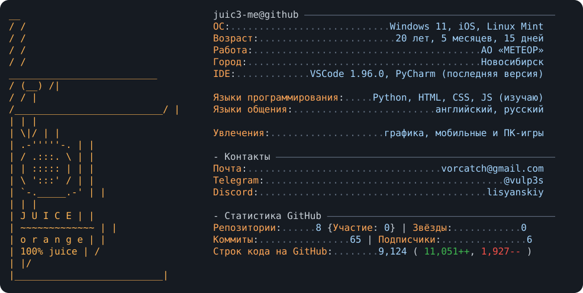
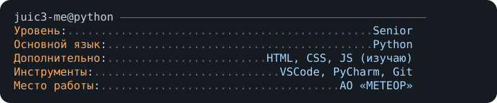

  <a href="https://github.com/Juic3-me">
    <picture>
      <source media="(prefers-color-scheme: dark)" srcset="dark_mode_ru.svg">
      <source media="(prefers-color-scheme: light)" srcset="light_mode_ru.svg">
      
    </picture>
  </a>

 

  
  &nbsp;&nbsp;
  

 

  <picture>
    <source media="(prefers-color-scheme: dark)" srcset="skills_dark_mode_ru.svg">
    <source media="(prefers-color-scheme: light)" srcset="skills_light_mode_ru.svg">
    
  </picture>

 

## Обо мне

Python-разработчик, город Новосибирск. Работаю в АО «МЕТЕОР».

## Профессиональный уровень

Python: Senior.

Python является основным языком в моей профессиональной работе. На нём я разрабатываю приложения, инструменты автоматизации и скрипты. Для работы с интерфейсами применяю HTML и CSS. JavaScript изучаю в настоящее время.

Области компетенции:

- разработка приложений на Python;
- автоматизация и написание скриптов;
- контроль версий в Git, размещение проектов на GitHub;
- разметка и стилизация интерфейсов на HTML и CSS.

## Языки

Английский и русский.

## Увлечения

Графика (рисование), мобильные и компьютерные игры.

## Технологии

  
  
  
  

  
  
  
  

  
  
  

## Контакты

  
  
  

